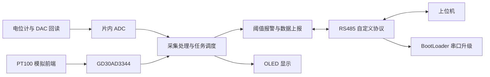

# 基于 GD32F470 的工业数据采集终端

2026 年 CIMC 工业嵌入式系统开发初赛软件工程，包含独立的 APP 和 BootLoader。基于 GD32F470、C 语言及 Keil MDK，采用驱动层、协议层、业务层分层组织与裸机协作式任务调度。

项目围绕“采集—处理—通信—报警—维护”完成终端软件开发：通过 ADC 获取模拟量并进行量程变比处理，通过 RS485 与上位机交互，并使用独立 BootLoader 完成串口固件更新。

## 技术栈

| 项目 | 实现 |
| --- | --- |
| 主控 | GD32F470VE，Arm Cortex-M4 |
| 开发环境 | C、Keil MDK、ARM Compiler 6.24（工程配置） |
| 软件组织 | 裸机协作式调度，驱动／协议／业务分层 |
| 通信 | RS485、USART DMA 环形接收、自定义帧协议 |
| 数据处理 | ADC 电压换算、变比处理、PT100 温度换算与滤波 |
| 存储与维护 | 片内 Flash 参数保存、独立 BootLoader 串口升级 |

## 系统流程



## 功能

- 电位计电压采集、DAC 输出与 ADC 回读。
- GD30AD3344 外部 ADC 读取、PT100 电阻和温度换算、滑动均值与指数平滑滤波。
- RS485 自定义 ASCII 十六进制帧协议，USART DMA 环形接收、状态机解析、CRC16-Modbus 校验；该协议不是标准 Modbus 协议。
- 设备发现、心跳、时间设置、设备 ID 与波特率配置。
- 采集变比与报警阈值设置、定时数据上报、主动与被动报警、日志查询及清除。
- 配置参数 Flash 保存、RTC 定时唤醒与外设恢复。
- 独立 BootLoader：串口固件接收、有效性检查、Flash 写入与应用跳转。

## 工程目录

```text
APP/
  Driver/       外设与板级驱动
  Protocol/     协议解析、封装与命令处理
  Function/     采集、报警、参数保存与任务调度
  System/       主程序和系统支持
  project/      Keil APP 工程与链接配置
BootLoader/
  Driver/       板级与 Flash 驱动
  Protocol/     升级协议与启动流程
  HeaderFiles/  启动和 Flash 布局定义
  project/      Keil BootLoader 工程与链接配置
```

## 构建与运行

1. 安装 Keil MDK、ARM Compiler 6.24（当前工程配置）及 GD32F4xx 设备支持。
2. 分别打开 `BootLoader/project/Project.uvprojx` 和 `APP/project/Project.uvprojx`。
3. 按工程自带的 `.sct` 链接配置分别构建和烧录。修改地址布局时需要同步核对启动跳转、向量表及参数区定义。
4. 使用匹配的硬件和 RS485 上位机联调；初始设备 ID 为 `0x0001`，默认波特率为 `19200`。

仓库保留提交源码和依赖文件，忽略编译产物、开发环境个人设置及历史调试文本。此次整理没有重新编译或进行硬件测试。

## 已有验证记录与完成度

以下来自 2026-06-08 提交附近保存的自动评测文件，不代表全部赛题要求均已完成：

- 1 秒周期上报收到 20/20 帧；5 秒周期上报收到 10/10 帧。
- 参数重启保持、CRC 错误帧、长度错误帧及非法命令处理通过对应检测。
- 错误固件拒绝、正确固件升级及升级后心跳和数据交互验证通过对应检测。
- BootLoader 初始化信息检测仅部分通过。
- 当前报警日志刷新函数仅清除脏标记，尚未实现实际 Flash 持久化。
- PT100 换算与滤波已在代码中实现；上述通信评测不能证明温度测量精度。

## 第三方代码

工程包含芯片厂商库、CMSIS 和其他第三方组件，其权利与使用条件以各组件原有文件中的许可证和版权声明为准。本仓库未额外授予这些组件的许可。
